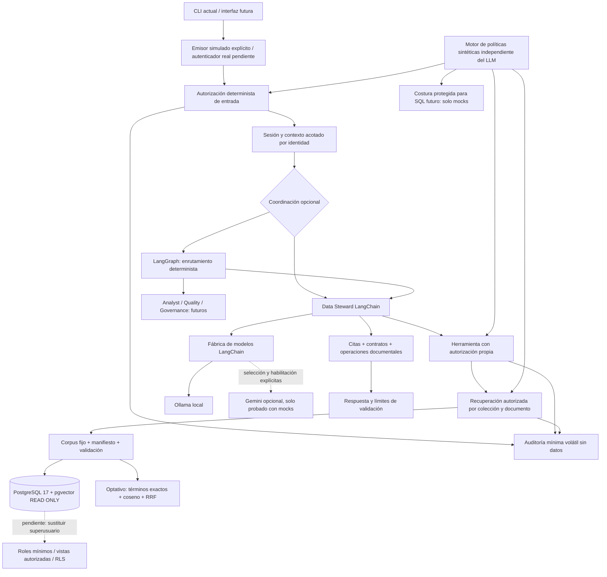

# Arquitectura vigente

El único especialista implementado es Data Steward. El objetivo principal de desarrollo es `new_bank_2026`; `legacy_metadata` continúa como default por compatibilidad hasta revisión de aceptación. La recuperación semántica sigue como default; para el catálogo nuevo, también el modo extractivo. El legado mantiene su contrato generativo histórico `AnswerDraft`, incluso cuando la opción compatible `response_mode` conserva el nombre `extractive`. Las rutas híbridas requieren selección explícita y catálogo nuevo.

## Componentes y responsabilidades

| Módulo | Responsabilidad |
| --- | --- |
| `bank_governance/config.py` | Configuración generativa tipada. Sin claves API en el objeto. Default heredado y límites explícitos. |
| `providers.py` | Fábrica local/Gemini opcional, identidad, compatibilidad declarada y telemetría segura. Nunca fallback local→cloud. |
| `contracts.py` | Evidencia, respuestas, afirmaciones atómicas, operaciones y solicitud/resultado de especialista. |
| `security_contracts.py`, `security.py` | Identidad/contexto, decisión, auditoría y núcleo de políticas sintéticas; default deny independiente del LLM. |
| `secured_retrieval.py` | Control por colección/documento antes de entregar evidencia, incluida la lectura léxica del manifiesto. |
| `context.py` | Pregunta y referentes en memoria volátil: conceptos, identificadores, producto, período, corpus y evidencia actual. |
| `retrieval.py` | Sesión de corpus y mejora optativa de recuperación; no ingiere datos. |
| `database.py` | Lectura publicada interna bajo guardas y transacción READ ONLY; no es herramienta SQL del LLM. |
| `tools.py` | Herramienta documental LangChain y comparación contra contenido/metadatos esperados. |
| `steward.py`, `prompts.py`, `policy.py` | Flujo del especialista, prompts y límites de capacidad. |
| `validation.py` | Validador temporal del experimento anterior; conservado para regresiones. |
| `hybrid.py` | Contrato nuevo optativo y validación por afirmación; distingue literal, operación y texto no certificado. |
| `coordinator.py` | Grafo mínimo real: ruta documental al Steward, error sanitizado y capacidades futuras no disponibles. |
| `cli.py` | Argumentos y presentación; no contiene fórmulas ni reglas bancarias. |
| `scripts/` | Adaptadores CLI antiguos, generación/publicación/backup explícitos y arneses históricos. No se ejecutan al abrir una sesión. |

La arquitectura tiene cuatro especialistas: Data Steward, Data Analyst, Data Quality y Data Governance. Solo Data Steward está implementado. Las otras tres capacidades devuelven `capability_unavailable`; su contrato común está en `SpecialistRequest`/`SpecialistResult` y su planificación en [security-and-governance.md](security-and-governance.md). No hay un cuarto agente generativo ni administración de accesos por LLM. MCP y Streamlit siguen pendientes.

## Amenazas, límites de confianza, autorización y auditoría

La capa transversal es determinista. Chat, documentos y salida del LLM son entradas no confiables y nunca emiten identidades o permisos. El anfitrión fija recurso, operación y contexto; un contrato tipado no acredita autenticación. La CLI exige `--simulated-user steward_demo` para la demostración documental: sin emisor confiable se deniega antes de crear el proveedor. Esa opción simula identidad y no autentica usuarios reales. Entrada, herramienta y recuperación vuelven a evaluar, con lo que omitir LangGraph no concede acceso. Se deniegan acciones/recursos desconocidos, escrituras y exports no aprobados; `requires_approval` también bloquea ejecución.

La clasificación de las 42 columnas es una [propuesta sintética revisable](data-classification-proposal.json), separada del catálogo publicado. Los actuales documentos se consideran metadatos internos; el adaptador no toma la sensibilidad del texto recuperado. El historial permanece por sesión, acotado y volátil; se vacía junto con evidencia/referentes cuando se deniega por revocación o caducidad. No se comparten cachés ni se guardan prompts en auditoría.

La auditoría SELECT encontró que `bank_governance_dev` es propietario, superusuario y BYPASSRLS. **Bloquea el despliegue real**: la política de aplicación no protege contra código anfitrión comprometido usando esa credencial. No se alteraron roles ni permisos. Vistas, roles mínimos, RLS, aislamiento multiusuario, retención durable de auditoría, DLP y autenticación productiva son diseño pendiente. Los controles nuevos se verificaron con identidades simuladas y mocks de herramientas SQL, sin DDL ni llamadas a modelos. El modelo de amenazas, resultados y plan completo están en [security-and-governance.md](security-and-governance.md) y [security-validation.json](security-validation.json).

## Flujo y contratos

La CLI abre una sesión con catálogo fijo. El Steward interpreta la pregunta mediante tool calling, ejecuta únicamente `search_data_catalog`, vuelve a etiquetar la evidencia por turno y después selecciona citas o propone afirmaciones. Dos llamadas de herramienta como máximo; cinco documentos por búsqueda ordinaria, doce para comparación reconocida, hasta 24 evidencias únicas por turno. La salida extractiva admite hasta doce etiquetas. Estos límites pueden producir respuestas incompletas y se mantienen visibles.

La recuperación `hybrid` puede hacer hasta dos búsquedas semánticas por invocación de herramienta (cuatro por turno como máximo), más coincidencias en el manifiesto verificado de 82 documentos. Combina rankings con `1/(60+rank)` y devuelve como máximo `k`. La expansión temporal relaciona conceptos y períodos; no calcula ni responde el saldo. El contexto estructurado del catálogo nuevo y sus punteros ayudan a resolver «el mes siguiente», pero las referencias de la respuesta pertenecen exclusivamente al turno actual. El historial legado conserva su representación anterior para evitar una regresión de compatibilidad.

`Evidence` conserva ID documental, modelo/corpus, texto, fuente, versión, puntero y afirmaciones con procedencia. `AgentReply` añade `validation_results` opcional sin romper las claves antiguas. `AtomicExplanation` contiene afirmaciones de tipo literal, inferencia o límite; cada una lleva IDs actuales y una operación opcional. Se comprueban calendario febrero–junio, signo por producto/código, identidad literal de fórmula y nulabilidad **upstream**. Es validación documental; no ejecuta controles sobre registros ni implementa el motor Data Quality.

Una operación correcta no garantiza que el texto natural que la acompaña sea verdadero. Solo una extracción literal puede marcarse `verified_literal`. Una inferencia queda como `operation_verified_semantics_unverified` o `review_required`; la respuesta usa `explanation_requires_review`. Las afirmaciones rechazadas quedan en el artefacto con motivo. Las fichas de ausencia pertinentes pueden explicar un límite aunque el LLM se abstenga; se exige coincidencia de un término documental en la pregunta actual. Ese criterio es finito y todavía requiere evaluación de ambigüedades.

## Datos, conocimiento y modelos

Los cinco originales `dim`/`cfg` contienen 350,013 filas; dos referencias auxiliares añaden 20,009. El catálogo nuevo tiene 82 documentos y 172 afirmaciones. El legado mantiene 6,500 filas y 24 documentos. No hay equivalencias implícitas entre catálogos. La selección del generador Ollama/Gemini no selecciona ni cambia el corpus o los embeddings bge-large/1024.

El backend histórico verifica manifiestos, contenidos y vectores y fija contenedor, base, volumen y puerto de desarrollo. Se conserva esa guarda deliberadamente: no se generaliza un destino de escritura durante este refactor. Los builders documentales y utilidades operativas siguen en `scripts/`; el paquete los consume detrás de adaptadores. Extraer toda la infraestructura de provisión no era necesario para el MVP y habría arriesgado controles probados.

No se añadió DDL. Para 82 documentos, una búsqueda exacta sobre el manifiesto ya validado evita una segunda fuente de contenido y permite probar RRF. PostgreSQL FTS (`tsvector`/GIN) podría sustituir esa parte cuando volumen y medición lo justifiquen; requeriría migración y ensayo aislado, pendientes. No se propone otro motor de búsqueda.

## Proveedores y observabilidad

`LLMConfig` separa proveedor, modelo, temperatura, timeout, contexto configurado, límite de salida y capacidades requeridas. Ollama consulta identidad y soporte de herramientas; la salida estructurada se comprueba al enlazar y al ejecutar. Gemini usa Developer API explícita, exige nombre de modelo, habilitación cloud y clave en el entorno; la dependencia se instala con el extra `cloud`. Se probó con mocks, sin invocaciones remotas. La capacidad declarada no acredita compatibilidad real de cualquier nombre de modelo; un fallo de binding o ejecución se informa sin sustitución automática. Claude es extensión futura, no adaptador instalado.

La telemetría permite proveedor/modelo, duración, tokens cuando se reportan, tamaño de entrada, contexto configurado, tamaño de evidencia, herramientas e indicios de truncamiento. No registra prompts, respuestas, credenciales ni razonamiento interno. Contexto configurado no significa ventana efectiva garantizada; falta de conteo significa desconocido. El trazado remoto de LangSmith se deshabilita tanto en llamadas del agente como al invocar el coordinador.

## LangGraph y extensibilidad

Se usa `StateGraph` instalado, con estado tipado y nodos `route`, `steward`, `unavailable`. No añade llamadas LLM al agente. El enrutamiento es deliberadamente limitado: capacidad explícita y guardas conservadoras para solicitudes operativas; no es un clasificador semántico general. La salida lleva evidencias y errores sanitizados. No hay checkpointer, paralelismo ni memoria persistente. Los futuros especialistas podrán devolver `SpecialistResult`; una futura composición deberá mantener procedencia y resultados parciales sin duplicar las reglas internas de los especialistas.

## Lectura y verificación

La guía de uso es [README](../README.md); la auditoría, cambios y pruebas están en [architecture-consolidation-report.md](architecture-consolidation-report.md); las decisiones en [architecture-decisions.md](architecture-decisions.md). Los siete conceptos están en [drafts/new-bank-concepts](drafts/new-bank-concepts/01-temporal.md) y no son corpus publicado. Los informes anteriores son evidencia histórica, especialmente [evaluación A/B/C](new-bank-data-steward-reasoning-evaluation.md). No representan aceptación del nuevo default.

APIs revisadas: [LangGraph Graph API](https://docs.langchain.com/oss/python/langgraph/graph-api) para estado/nodos/compilación; [integración Gemini](https://docs.langchain.com/oss/python/integrations/chat/google_generative_ai) para el adaptador LangChain opcional y backend explícito. El lockfile registra las versiones concretas utilizadas.
