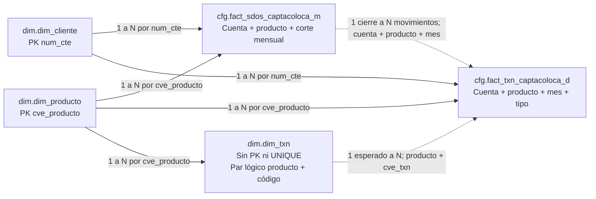
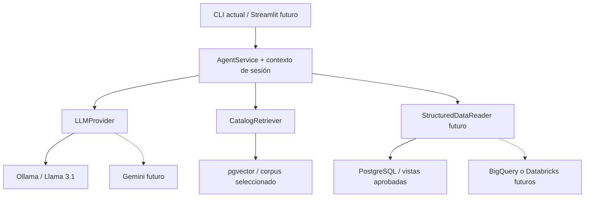

# Auditoría y plan de integración del nuevo modelo bancario

Fecha: 21 de octubre de 2026. Estado: **propuesta para revisión; sin ejecución de cambios en la base de datos**.

## 1. Alcance y conclusión

Los tres SQL describen un laboratorio sintético de cinco tablas: tres dimensiones en `dim` y dos tablas de hechos en `cfg`. El universo previsto es de 5,000 clientes, cuatro productos, 20,000 cuentas, 120,000 cierres mensuales de enero a junio de 2026 y 225,000 movimientos de febrero a junio. Las cuentas no tienen una tabla maestra independiente en el modelo recibido.

**No se recomienda ejecutar directamente los archivos upstream sobre la base compartida.** El primero elimina dimensiones con `CASCADE`; ninguno crea `cfg`; los otros dos contienen DDL anterior a `BEGIN` y no toleran que sus tablas ya existan. Además, `dominio` cambia de vocabulario entre enero y los meses siguientes, y `saldo_apertura` cambia de significado temporal.

Se propone mantener íntegros los originales, preparar migraciones y un cargador derivados por separado, preservar los valores de origen, validar antes de publicar y aislar el nuevo corpus del anterior. El modelo previo y el nuevo coexistirían sin equivalencias automáticas entre sus clientes, segmentos, préstamos o transacciones.

### 1.1 Qué se verificó y qué queda pendiente

Esta auditoría realizó lectura de archivos, revisión de código y pruebas existentes, conteos derivados del SQL y huellas SHA-256. No se conectó a PostgreSQL ni Ollama, no ejecutó los SQL, no inició o reinició Docker, no generó datasets ni embeddings y no cambió el agente. La existencia real de `dim`/`cfg`, los permisos, los objetos y los conteos actuales de la base **no se comprobaron**.

No se ejecutó la suite: sus pruebas de integración crean esquemas/tablas y filas aunque luego hagan rollback, y varias unitarias generan la muestra anterior en memoria. El alcance solicitado es análisis estático. Las **134 pruebas aprobadas** son evidencia histórica de `docs/agent-validation.json`, fechada el 20 de octubre de 2026; no un resultado nuevo de esta auditoría.

Convenciones de procedencia usadas en el documento y propuestas para el catálogo:

| Etiqueta | Significado |
| --- | --- |
| **Fuente** | Declaración, comentario o comportamiento literal de los SQL recibidos. |
| **Inferencia** | Consecuencia técnica derivada de esas declaraciones; no definición oficial del negocio. |
| **Propuesta MVP** | Control, interfaz o documentación que proponemos agregar; no política oficial de Banamex. |
| **Por aclarar** | Definición que los archivos no resuelven o contienen de forma ambigua. |

### 1.2 Fuentes locales y trazabilidad

Abreviaturas empleadas en las referencias de línea:

| ID | Archivo recibido | SHA-256 de los bytes originales |
| --- | --- | --- |
| U1 | [001_dimensiones_cliente_producto_txn.sql](../sql/upstream/001_dimensiones_cliente_producto_txn.sql) | `eee849f1bfbdc138291a81682a0ed836ac5dbd37b9c499c2a00a273377e7696a` |
| U2 | [002_generar_cuentas_y_saldos_enero_2026.sql](../sql/upstream/002_generar_cuentas_y_saldos_enero_2026.sql) | `6dfc90c1e55b2092584499c05a74b55309aeda004d8ce135e0bc7e6f765ecd2b` |
| U3 | [003_generar_transacciones_y_saldos_feb_jun_2026.sql](../sql/upstream/003_generar_transacciones_y_saldos_feb_jun_2026.sql) | `d28d22b90e9882fa3780c23d1107df79ce72f9556ba8351d505eb108b0756fa3` |

Los tres archivos ya estaban presentes y aparecían como `?? sql/upstream/` en Git al comenzar. No deben confundirse con archivos creados por esta tarea. Conviene incorporarlos posteriormente al control de versiones junto con estas huellas, sin normalizar saltos de línea ni editar su contenido inadvertidamente.

## 2. Arquitectura existente: reutilización y ampliaciones

Se revisaron `README.md`, `pyproject.toml`, configuración de pytest, `compose.yaml`, `.env.example`, `docker/postgres/init/001-enable-vector.sql`, las dos migraciones actuales, los tres módulos Python, documentación, fuentes/artifactos del corpus y las pruebas de `tests/`. No se leyó ni publicó el contenido de `.env`.

| Componente | Evidencia actual | Reutilización y ampliación futura |
| --- | --- | --- |
| Infraestructura | PostgreSQL 17, imagen `pgvector/pgvector:0.8.7-pg17-bookworm`, puerto `127.0.0.1:5434`, volumen nombrado persistente. Solo se monta el SQL que habilita `vector`. | Reutilizar la instancia y extensión. Los upstream no son scripts de arranque y no hay motivo para montarlos en `docker-entrypoint-initdb.d` ni recrear el volumen. |
| Datos anteriores | `sql/001-create-bank-tables.sql`: `public."CUSTOMER"`, `public."TRANSACTION"`, `public."LOAN"`, con PK, FK, NOT NULL y CHECK. Generador: 1,000/5,000/500 filas, semilla `20261020`. | Conservar nombres, datos, reglas y generador. No sustituir el JSON anterior ni ampliar sus constantes para fingir que ambos modelos son el mismo. |
| `scripts/bank_data.py` | Catálogo y tablas fijados explícitamente; validación de huella, comparación de esquema, carga atómica, rechazo de estados parciales y repetición sin cambios. Conexión local fija. | Reutilizar los patrones de seguridad y manejo de secretos en módulos nuevos. `settings()` requiere separarse después de la lógica del modelo. `verify()` no es una consulta inocua: bloquea tablas y `check_schema()` crea un esquema de referencia dentro de rollback; no usarlo como verificador de solo lectura en esta etapa. |
| Corpus anterior | `data/source/bank_metadata.json`; 24 documentos en `data/corpus/bank_metadata.documents.jsonl`. SQL plantilla de `bank_knowledge.corpora/documents`; embedding medido, documentado como 1,024 componentes. | Conservar fuente, JSONL, tablas, vectores y manifiesto. Reutilizar contratos de documento, identidades por hash/digest y validación de dimensión en almacenamiento separado. |
| `scripts/knowledge_corpus.py` | `build_documents`, `expected_manifest`, rutas y constantes dependen del JSON antiguo. `RetrievalSession` reconstruye esa identidad; `search_store` sí filtra por `corpus_id`. Ingestión con bloqueo transaccional e identidad de modelo. | El parámetro `schema` de varias funciones no basta: la fuente/manifiesto/sesión también están acoplados. Extraer posteriormente configuración de corpus y constructor de fuente, preservando el comportamiento anterior. |
| Agente | `scripts/data_steward_agent.py`: `DataStewardAgent(model, retriever)`, una herramienta `search_data_catalog`, máximo dos búsquedas, respuesta Pydantic, referencias construidas desde evidencia del turno, historial acotado y errores saneados. | Mantener orquestación y contratos. Ampliar después el modelo de evidencia, la resolución de tablas y el registro de herramientas. No necesita una arquitectura multiagente para este alcance. |
| Límites del agente | Prompt restringido a tipos lógicos `STRING/FLOAT/INTEGER`; `_ground` reconoce campos solo de `CUSTOMER/TRANSACTION/LOAN`; `_supports_field` presupone contenido JSON; `Evidence` requiere `json_pointer`. `agent_session` construye `ChatOllama` directamente. | No basta con indexar SQL: habrá que aceptar nombres calificados con esquema, tipos físicos, procedencia SQL y corpus seleccionado. Conservar regresiones del modelo anterior. |
| Seguridad actual | Acceso con usuario de desarrollo, no roles efectivos de usuarios finales. Los atajos de solicitudes fuera de alcance son UX; recuperación no declara una transacción READ ONLY. Trazado remoto del agente deshabilitado. | Agregar roles PostgreSQL y límites reales antes de herramientas analíticas. No confundir prompts, expresiones regulares o ausencia de herramientas de escritura con autorización en la base. |
| Pruebas | `test_synthetic_data`, `test_database`, `test_knowledge_corpus`, `test_corpus_database`, `test_semantic_retrieval`, `test_data_steward_agent`, `test_agent_integration`; fixtures y casos de recuperación/agente. | Conservar los contratos anteriores. Agregar suites independientes para nuevo esquema, carga, calidad, aislamiento entre modelos y adaptadores. Las pruebas con DB requieren autorización posterior aunque sus cambios se reviertan. |
| Organización | Implementación funcional en `scripts/`; `src/` sin implementación inspeccionable. `uv.lock` fija dependencias; todavía no se declaran Streamlit ni un proveedor Gemini. | Introducir gradualmente un paquete bajo `src/`, conservando las CLI actuales como entradas compatibles. No instalar dependencias en esta tarea. |

## 3. Modelo recibido: tablas, columnas y restricciones

Los tipos son los del DDL. `int4` equivale a `INTEGER`. En este apartado **nullable** describe lo que permite la tabla, no necesariamente lo que genera la carga. Hay 42 columnas en las cinco tablas; solo dos PK declaradas y ninguna FK declarada entre ellas.

### 3.1 `dim.dim_cliente` — U1, líneas 12–27

Grano: una fila por `num_cte`.

| Columna | Tipo | ¿NULL permitido? | Definición o uso en la fuente |
| --- | --- | --- | --- |
| `num_cte` | `INTEGER` | No | PK; IDs de 1 a 5,000. |
| `fec_alta` | `DATE` | Sí | Fecha sintética de alta del cliente; fórmula independiente de nacimiento. |
| `fec_nac` | `DATE` | Sí | Fecha generada para PF y PM. El significado para PM no se explica. |
| `tipo_persona` | `VARCHAR(10)` | Sí | CHECK admite `PF`, `PM`; carga asigna 4,800 y 200 respectivamente. |
| `genero_cte` | `VARCHAR(10)` | Sí | CHECK admite `HOMBRE`, `MUJER`, `NO APLICA`; la carga usa el último para PM. |
| `segmento_cte` | `VARCHAR(20)` | Sí | Se genera `PREMIUM`, `PREFERENTE`, `MASIVO`; sin CHECK de catálogo. |
| `giro_empresa` | `VARCHAR(30)` | Sí | No se puebla ni se proporciona catálogo. |
| `cve_territorio` | `VARCHAR(255)` | Sí | No se puebla ni se proporciona dimensión de referencia. |
| `cve_dir` | `VARCHAR(255)` | Sí | No se puebla; no afirmar que sea dirección postal. |
| `cve_subdir` | `VARCHAR(255)` | Sí | No se puebla; significado detallado no documentado. |
| `cve_sucursal` | `INTEGER` | Sí | No se puebla ni se proporciona catálogo. |
| `cve_promotor` | `VARCHAR(10)` | Sí | No se puebla ni se proporciona catálogo. |

**Fuente:** las fechas se calculan como días desde una base: PF `1945-01-01 + MOD(num_cte*37,21915)`; PM `1960-01-01 + MOD(num_cte*53,23742)`; alta `2000-01-01 + MOD(num_cte*97,7305)`. La validación de mayoría de edad utiliza **2026-07-15**, no la fecha actual ni la fecha de apertura de cuenta.

**Inferencia:** los seis campos no poblados quedan NULL en los 5,000 clientes. Los CHECK de persona y género no obligan a poblarlos ni relacionan ambos valores. PostgreSQL acepta un CHECK que resulta NULL; se necesita NOT NULL si se quiere impedirlo. [Restricciones en PostgreSQL 17](https://www.postgresql.org/docs/17/ddl-constraints.html).

### 3.2 `dim.dim_producto` — U1, líneas 82–97

Grano: una fila por `cve_producto`.

| Columna | Tipo | ¿NULL permitido? | Restricción/uso |
| --- | --- | --- | --- |
| `cve_producto` | `VARCHAR(40)` | No | PK. |
| `cve_dominio` | `VARCHAR(20)` | No | CHECK en `DEPOSITS`, `LENDING`, `TDC`. |
| `grupo_producto` | `VARCHAR(20)` | No | La carga usa `CAPTACION` o `COLOCACION`; sin CHECK propio ni de correspondencia con dominio. |
| `cve_subproducto` | `VARCHAR(40)` | No | Igual al producto en las cuatro filas; sin UNIQUE independiente. |
| `descripcion` | `VARCHAR(100)` | Sí | Nombre legible del producto. |
| `activo` | `BOOLEAN` | Sí | DEFAULT TRUE; no es NOT NULL. La carga de enero requiere `activo IS TRUE`. |

Catálogo completo **proporcionado**:

| Producto | Dominio | Grupo | Subproducto | Descripción | Cuenta por cliente | Saldo inicial permitido |
| --- | --- | --- | --- | --- | --- | --- |
| `CHEQUES` | `DEPOSITS` | `CAPTACION` | `CHEQUES` | Cuenta de Cheques | Una | 8,000.00–12,000.00 |
| `AHORRO` | `DEPOSITS` | `CAPTACION` | `AHORRO` | Cuenta de Ahorro | Una | 5.00–10,000.00 |
| `C_PERSONAL` | `LENDING` | `COLOCACION` | `C_PERSONAL` | Crédito Personal | Una | 50,000.00–85,000.00 |
| `TDC` | `TDC` | `COLOCACION` | `TDC` | Tarjeta de Crédito | Una | 10,000.00–120,000.00 |

Los importes no tienen columna de moneda ni unidad declarada en estos SQL. No heredar MXN de `bank_metadata.json`: ese archivo pertenece al otro modelo.

### 3.3 `dim.dim_txn` — U1, líneas 101–119

Grano lógico previsto: una definición de movimiento por producto y código. **Sin PK ni UNIQUE por decisión explícita del archivo.** Tampoco hay FK a producto ni CHECK de dominio/grupo.

| Columna | Tipo | ¿NULL permitido? |
| --- | --- | --- |
| `cve_producto` | `VARCHAR(40)` | No |
| `cve_dominio` | `VARCHAR(20)` | No |
| `grupo_producto` | `VARCHAR(20)` | No |
| `cve_txn` | `INTEGER` | No |
| `desc_txn` | `VARCHAR(40)` | No |

Catálogo completo y efecto económico **proporcionado por U1 y U3**:

| Producto | Código | Descripción exacta | Dominio | Grupo | Efecto sobre el saldo del producto |
| --- | ---: | --- | --- | --- | ---: |
| CHEQUES | 100 | DEPOSITO | DEPOSITS | CAPTACION | + |
| CHEQUES | 200 | RETIRO | DEPOSITS | CAPTACION | − |
| AHORRO | 100 | DEPOSITO | DEPOSITS | CAPTACION | + |
| AHORRO | 200 | RETIRO | DEPOSITS | CAPTACION | − |
| C_PERSONAL | 300 | PAGOS | LENDING | COLOCACION | − |
| C_PERSONAL | 450 | DISPOSICIONES | LENDING | COLOCACION | + |
| TDC | 300 | PAGOS | TDC | COLOCACION | − |
| TDC | 400 | COMPRAS | TDC | COLOCACION | + |
| TDC | 450 | DISPOSICIONES | TDC | COLOCACION | + |

Los códigos 100, 200, 300 y 450 tienen dos filas cada uno; 400 tiene una. Es una repetición **válida entre productos**, no un error a corregir con `DISTINCT`. El par `(cve_producto,cve_txn)` es único en las nueve filas recibidas, pero la base no garantiza que siga siéndolo.

### 3.4 `cfg.fact_sdos_captacoloca_m` — U2, líneas 30–40

Grano inferido: un saldo de cuenta/producto por fecha de corte mensual. No tiene PK, UNIQUE, FK, CHECK, índices explícitos ni columnas NOT NULL.

| Columna | Tipo | ¿NULL permitido? | Semántica en la generación |
| --- | --- | --- | --- |
| `num_cta` | `int4` | Sí | Identificador sintético de cuenta. |
| `num_cte` | `int4` | Sí | Cliente dueño según la carga; sin integridad referencial declarada. |
| `cve_producto` | `VARCHAR(40)` | Sí | Uno de los cuatro productos. |
| `fec_alta` | `DATE` | Sí | Apertura de la **cuenta**, siempre `2026-01-01`; no es el alta del cliente. |
| `cve_mes_alta` | `int4` | Sí | Mes de apertura `202601`; permanece igual en los seis cortes. |
| `saldo_apertura` | `NUMERIC(18,2)` | Sí | Enero: saldo inicial de la cuenta. Febrero–junio: cierre del mes anterior, es decir, inicio del mes actual. |
| `saldo_mes` | `NUMERIC(18,2)` | Sí | Cierre del mes; enero iguala el saldo inicial. |
| `fec_informacion` | `int4` | Sí | Corte en formato `YYYYMMDD`, no un tipo DATE. |
| `dominio` | `VARCHAR(20)` | Sí | Enero: `CAPTACION/COLOCACION`. Febrero–junio: `DEPOSITS/LENDING/TDC`. |

Las cuentas se asignan usando `ROW_NUMBER() OVER (ORDER BY num_cte)-1`, no sumando directamente `num_cte`. Con U1 intacto, cuenta = base + `num_cte` − 1. La prueba de U2 cuenta clientes pero no exige que sus IDs sean precisamente 1–5,000; con otro conjunto de IDs de igual tamaño la asignación cambia.

### 3.5 `cfg.fact_txn_captacoloca_d` — U3, líneas 47–58

Grano sintético inferido: una operación de cada tipo aplicable por cuenta/producto/mes. No hay identificador de evento, PK, UNIQUE, FK, CHECK ni índices explícitos; todas las columnas admiten NULL.

| Columna | Tipo | ¿NULL permitido? | Semántica en la generación |
| --- | --- | --- | --- |
| `num_cta` | `int4` | Sí | Cuenta asociada. |
| `num_cte` | `int4` | Sí | Cliente asociado, heredado del saldo previo. |
| `cve_producto` | `VARCHAR(40)` | Sí | Producto de la cuenta. |
| `fec_txn` | `DATE` | Sí | Todas las operaciones se sitúan el día 15 del mes. |
| `cve_mes_txn` | `int4` | Sí | Mes de la operación: `202602` a `202606`. |
| `saldo_txn` | `NUMERIC(18,2)` | Sí | Importe positivo del movimiento, no saldo posterior ni importe con signo. |
| `cve_txn` | `int4` | Sí | Código que se interpreta junto con producto. |
| `desc_txn` | `VARCHAR(40)` | Sí | Descripción escrita por CASE; no se recupera mediante JOIN al catálogo. |
| `fec_informacion` | `int4` | Sí | Último día del mes de la operación, en `YYYYMMDD`; no fecha de ejecución del script. |
| `dominio` | `VARCHAR(20)` | Sí | Dominio técnico `DEPOSITS/LENDING/TDC`. |

El sufijo `_d` no prueba que exista una serie diaria completa. No hay horas, orden intradía, canal, comercio, moneda, interés, tasa contractual, mora, límite de crédito, reversos ni estados de cuenta definidos en estos hechos. La ausencia se limita a los archivos recibidos.

## 4. Diagrama lógico y reglas de JOIN

El diagrama muestra relaciones **lógicas esperadas**, no FK que ya existan. Los hechos se relacionan por cuenta/producto y período; la dimensión de cuenta no existe en upstream.

Reglas de consulta y cardinalidad propuestas:

| Relación | Condición correcta | Precaución |
| --- | --- | --- |
| Hechos → cliente | `hecho.num_cte = cliente.num_cte` | Exigir cero huérfanos; no relacionar con `CUSTOMER.customer_id`. |
| Hechos → producto | `hecho.cve_producto = producto.cve_producto` | Para histórico no filtrar ciegamente por `activo IS TRUE`; el estado futuro del catálogo no debe ocultar hechos previos. |
| Movimiento → catálogo transaccional | `mov.cve_producto = txn.cve_producto AND mov.cve_txn = txn.cve_txn` | Verificar primero una sola definición por par; incluso el JOIN compuesto multiplica filas si el catálogo contiene duplicados del par. |
| Movimiento → cierre | Cuenta + producto + `cve_mes_txn = mes(fec_informacion_del_cierre)` | Agregar movimientos al grano mensual antes de sumar o comparar saldos. Un JOIN directo repite el cierre dos o tres veces. |
| Cierre → cierre anterior | Cuenta + producto + fecha exacta del último día del mes anterior | No unir solo por cuenta ni usar la fila previa disponible como prueba de continuidad mensual. |
| Cuenta → cliente dueño | Una sola pareja cliente/producto por cuenta en todos los cortes y movimientos | `num_cte` debe ser coherente entre hechos, no basta con que exista en la dimensión. |

No utilizar `cve_mes_alta` para identificar el mes del saldo: seleccionaría los seis cortes. No usar `dominio` crudo como clave de JOIN por el cambio de vocabulario. No tratar `desc_txn` como clave estable. La coincidencia de nombres o números con el modelo anterior no establece identidad de clientes o productos.

## 5. Dependencias y conteos esperados

### 5.1 Orden y precondiciones

Secuencia lógica de la fuente: U1 → U2 → U3. Además se requiere que `cfg` exista antes de U2; ese requisito no lo satisface ninguno de los tres archivos. U1 solo crea `dim`.

U2 exige 5,000 filas en clientes y exactamente cuatro productos esperados activos. U3 exige 5,000 clientes distintos, 20,000 filas de enero y ausencia de movimientos/cierres de febrero–junio. Esos conteos no prueban por sí solos claves, cobertura por producto o pertenencia de cuenta a cliente.

U3 utiliza las filas del cierre anterior para calcular cada mes siguiente. Sus códigos, dominios y grupos se construyen por CASE; no depende de `dim.dim_txn` para generar ni validar los movimientos. Por ello un catálogo alterado no necesariamente hace fallar la carga.

### 5.2 Dimensiones y cuentas

| Conjunto | Conteo esperado | Derivación |
| --- | ---: | --- |
| Clientes | 5,000 | IDs 1–5,000. |
| PF / PM | 4,800 / 200 | Umbral de ID 4,800. |
| Hombres PF / mujeres PF | 2,496 / 2,304 | Umbral de ID 2,496 dentro de PF. PM: 200 con `NO APLICA`. |
| PREMIUM / PREFERENTE / MASIVO | 250 / 1,000 / 3,750 | Residuo módulo 100: `<5`, `<25`, resto; inferencia exacta sobre 1–5,000. |
| Productos | 4 | Todos insertados activos por DEFAULT. |
| Definiciones de transacción | 9 | Dos por CHEQUES, AHORRO y C_PERSONAL; tres por TDC. |
| Cuentas distintas | 20,000 | Cuatro por cliente, 5,000 por producto. |

| Producto | Rango inclusivo de cuenta | Cuentas |
| --- | --- | ---: |
| CHEQUES | 100000–104999 | 5,000 |
| AHORRO | 200000–204999 | 5,000 |
| TDC | 300000–304999 | 5,000 |
| C_PERSONAL | 400000–404999 | 5,000 |

### 5.3 Hechos por período

| Mes | Corte `fec_informacion` | Saldos nuevos | Movimientos nuevos | Fecha de operación |
| --- | ---: | ---: | ---: | --- |
| Enero | 20260131 | 20,000 | 0 | Sin movimientos generados en enero. |
| Febrero | 20260228 | 20,000 | 45,000 | 2026-02-15 |
| Marzo | 20260331 | 20,000 | 45,000 | 2026-03-15 |
| Abril | 20260430 | 20,000 | 45,000 | 2026-04-15 |
| Mayo | 20260531 | 20,000 | 45,000 | 2026-05-15 |
| Junio | 20260630 | 20,000 | 45,000 | 2026-06-15 |
| **Total** | Seis cortes | **120,000** | **225,000** | Cinco meses de operaciones. |

| Producto | Saldos enero–junio | Movimientos por mes febrero–junio | Movimientos en cinco meses |
| --- | ---: | ---: | ---: |
| CHEQUES | 30,000 | 10,000 | 50,000 |
| AHORRO | 30,000 | 10,000 | 50,000 |
| C_PERSONAL | 30,000 | 10,000 | 50,000 |
| TDC | 30,000 | 15,000 | 75,000 |
| **Total** | **120,000** | **45,000** | **225,000** |

Al finalizar correctamente existirían **350,013 filas** entre las cinco tablas: 5,000 + 4 + 9 + 120,000 + 225,000. No se suman 20,000 cuentas como filas de una sexta tabla inexistente. Los totales monetarios exactos no pueden anticiparse sin fijar los saldos aleatorios de enero.

## 6. Reglas financieras, temporales y de generación

### 6.1 Captación y colocación en este laboratorio

**Fuente:** CHEQUES y AHORRO son captación; C_PERSONAL y TDC, colocación. Para captación, depósitos aumentan el saldo y retiros lo disminuyen. Para colocación, disposiciones/compras aumentan la deuda y pagos la disminuyen.

**Inferencia/documentación propuesta:** interpretar captación como saldo depositado y colocación como deuda del cliente permite explicar el signo de los movimientos en este ejercicio. No convertir estas reglas en contabilidad de doble partida, política oficial, reglas de aprobación, rentabilidad o medición de riesgo. Los SQL no definen esas extensiones. Un aumento de deuda no implica utilidad ni mejor calidad crediticia.

Los importes de `saldo_txn` se almacenan positivos. La operación correcta es aplicar el signo de la tabla de producto/código antes de sumar. Sumar los importes sin signo mide volumen bruto, no variación de saldo.

### 6.2 Cálculos mensuales exactos

Para cada cuenta, sea `A` el cierre del mes anterior, `r` la tasa objetivo de crecimiento, `C = ROUND(A*(1+r),2)` y `I = C-A`.

| Período | Captación | Colocación |
| --- | ---: | ---: |
| Febrero respecto a enero | 2.0% | 3.0% |
| Marzo, abril, mayo y junio respecto al cierre anterior | 1.0% mensual | 2.2% mensual |

| Producto | Importes generados | Identidad de cierre |
| --- | --- | --- |
| CHEQUES / AHORRO | `retiro = ROUND(A*0.05,2)`; `deposito = retiro + I` | `C = A + deposito - retiro` |
| C_PERSONAL | `pago = ROUND(A*0.05,2)`; `disposicion = pago + I` | `C = A + disposicion - pago` |
| TDC | `compras = ROUND(A*0.02,2)`; `disposiciones = ROUND(A*0.02,2)`; `pagos = compras + disposiciones - I` | `C = A + compras + disposiciones - pagos` |

U3 calcula una vez los importes en `tmp_calculo_mes`, reutiliza esos valores para movimientos y cierres, y rechaza importes NULL o no positivos. Los saldos válidos de enero y las tasas dadas hacen positivos los importes de TDC; esa garantía no es universal si se cambian tasas/rangos o se admiten datos externos.

La tasa determina **crecimiento sintético del saldo**, no intereses devengados ni una tasa de crédito o rendimiento contractual. El objetivo se impone primero y los flujos se ajustan para alcanzarlo. No son operaciones bancarias observadas ni una simulación de comportamiento independiente.

Se redondea cada cierre de cada cuenta cada mes con aritmética decimal. Una fórmula global compuesta sin redondeos intermedios o un promedio de porcentajes puede diferir del resultado por cuenta. Los límites iniciales de U2 no limitan los cierres posteriores; no rechazar un saldo de junio solo por superar el máximo inicial de enero.

Ejemplos aritméticos de documentación, no registros cargados: con A=10,000.00 en CHEQUES en febrero, C=10,200.00, retiro=500.00 y depósito=700.00. Con A=10,000.00 en TDC, compras=200.00, disposiciones=200.00, pagos=100.00 y C=10,300.00.

### 6.3 Fechas y saldos que no deben confundirse

| Campo/concepto | Interpretación fiel |
| --- | --- |
| `dim_cliente.fec_alta` | Alta sintética de cliente; distinta de alta de cuenta. |
| `fact_sdos.fec_alta` | Apertura de cuenta el 1 de enero de 2026, propagada sin cambio a meses posteriores. |
| `cve_mes_alta` | Cohorte/mes de apertura de cuenta. Sigue en `202601` aun en el cierre de junio. |
| `cve_mes_txn` | Mes de operación. Debe coincidir con año/mes de `fec_txn`. |
| `fec_txn` | Día de movimiento, siempre día 15 en esta muestra. Sin secuencia intradía. |
| `fec_informacion` | Corte mensual: entero `YYYYMMDD`; en hechos de movimientos identifica el corte, no el día de operación. |
| `saldo_apertura` enero | Saldo inicial de cuenta, igual a cierre de enero; no existen movimientos de enero para explicar su origen. |
| `saldo_apertura` febrero–junio | Saldo al inicio de ese mes, tomado del `saldo_mes` anterior. No repetirlo como saldo original de la cuenta. |
| `saldo_mes` | Foto de cierre, sumable entre cuentas para un mismo corte. Sumarlo entre meses cuenta varias veces el mismo stock. |

**Propuesta MVP:** exponer fechas DATE derivadas validadas, `mes_corte`, `saldo_inicio_mes` y, si se necesita, `saldo_inicial_cuenta` obtenido del corte de enero. Mantener los nombres/valores de origen y describir explícitamente la derivación. No reemplazar silenciosamente `saldo_apertura`.

### 6.4 Supuestos sintéticos y reproducibilidad

Las asignaciones de persona, género, segmento, fechas e IDs son determinísticas por ID. No son muestras aleatorias de una población: ID revela categorías y las fechas se generan de forma independiente. Todos los clientes, incluidas PM, reciben todos los productos; su elegibilidad comercial no está definida.

U2 usa `RANDOM()` sin `setseed`; los saldos se aproximan a una distribución uniforme dentro de cada intervalo y se redondean a centavos. No es una distribución uniforme exacta sobre todos los centavos. El redondeo permite alcanzar los extremos declarados, sin asegurar que aparezcan en una muestra concreta. Las tasas y movimientos de U3 son determinísticos **condicionados a los saldos de enero**; no hay nuevas altas, bajas, impagos o cambios de producto.

**Propuesta MVP preferida:** conservar una instantánea de enero como artefacto de entrada con checksum; derivar febrero–junio de ella. Para el primer conjunto reproducible, preparar un generador derivado que asigne centavos de forma determinística por semilla + cuenta + producto + versión del algoritmo, documentando que es una adaptación, no ejecución idéntica del SQL original. Si se exige conservar la secuencia de `RANDOM()`, fijar semilla y versión/orden de evaluación y guardar igualmente la instantánea; una semilla sola no prueba reproducibilidad entre planes o versiones. No cambiar el generador anterior.

## 7. Validaciones que ya contienen los SQL

| Script | Controles que detienen la carga | Consultas informativas y límites |
| --- | --- | --- |
| U1 | PK de cliente/producto, NOT NULL declarados y tres CHECK. BEGIN/COMMIT envuelven dimensiones. | SELECT de mayoría de edad antes de COMMIT; después, conteos/IDs, proporciones, fechas y nulos, productos/transacciones y códigos repetidos entre productos. Ninguno de esos SELECT exige resultado esperado ni hace RAISE. |
| U2 | DO: total de 5,000 clientes, cuatro productos esperados activos, ausencia de filas de esos productos con `cve_mes_alta=202601`. | Antes de COMMIT: resúmenes por producto, totales, cuentas/clientes distintos, nulos de saldos, rangos y cuatro productos por cliente. Son SELECT; no abortan si encuentran anomalías. El filtro de cohorte no equivale a un corte exclusivo de enero después de U3. El filtro `NOT(rango)` no detecta NULL por lógica ternaria. |
| U3 | DO: 5,000 clientes distintos, 20,000 filas de enero, ausencia de movimientos/cierres del período; 20,000 filas temporales cada mes; ROW_COUNT=45,000 movimientos y 20,000 saldos; importes NULL/≤0 causan excepción. | Después de COMMIT: movimientos por mes/producto; crecimiento con LAG; conciliación con signo. No detienen ni revierten la transacción ya confirmada. No verifican todas las claves, fechas, dominios o relaciones. |

La conciliación final de U3 (líneas 432–488) usa INNER JOIN y `ELSE 0`, y solo muestra diferencias **mayores** a 0.01. Puede omitir cuentas sin movimientos, movimientos sin cierre, códigos desconocidos, operandos NULL y una diferencia exacta de un centavo. El crecimiento con LAG no exige que la fila previa sea del mes inmediatamente anterior y el orden es ambiguo si hay cierres duplicados. Son huecos del control, no prueba de que la carga limpia genere esas anomalías.

## 8. Hallazgos: errores, riesgos y decisiones

### 8.1 Defectos o comportamientos comprobables por lectura

| ID | Severidad | Evidencia | Consecuencia y tratamiento propuesto |
| --- | --- | --- | --- |
| E1 | Crítica | U1 líneas 11, 81, 99: tres `DROP TABLE ... CASCADE`. | Borra datos de dimensiones al repetirse y elimina dependencias. CASCADE puede borrar vistas y quitar FK de otras tablas; no significa que siempre borre las tablas hijas. No ejecutarlo en la base compartida; crear DDL derivado sin borrados. [Semántica oficial de DROP TABLE](https://www.postgresql.org/docs/17/sql-droptable.html). |
| E2 | Alta | Solo U1 crea `dim`; ningún archivo crea `cfg`. | En una base sin `cfg`, U2 falla al crear la tabla. Es un requisito no satisfecho por la secuencia recibida; no se afirma que falte en la instancia actual. |
| E3 | Alta | U2 línea 30 antes de BEGIN línea 42; U3 línea 47 antes de BEGIN línea 60. CREATE sin IF NOT EXISTS. | En ejecución habitual con psql/autocommit la tabla puede quedar creada/vacía si falla la transacción de carga. Al reintentar, CREATE falla antes del control de duplicados. Otro cliente podría envolver el archivo de otra forma: no hay atomicidad autónoma garantizada por esos límites. Separar DDL y DML derivados. |
| E4 | Alta | U2 `p.dominio`: grupo; U3 `c.cve_dominio`: dominio técnico (líneas 259, 285, 298, 339). | Mismo campo de saldos con vocabularios diferentes por corte. Conservar `dominio` crudo y derivar dominio/grupo explícitos desde producto; no interpretar toda la columna con un único catálogo. |
| E5 | Alta | DDL de ambos hechos: todas las columnas NULL y sin claves/FK/CHECK. `dim_txn` sin PK/UNIQUE explícitamente. | La estructura permite duplicados, huérfanos, fechas inválidas y valores inconsistentes. Fortalecer mediante migración revisada y/o referencias auxiliares; no afirmar integridad ya existente. |
| E6 | Alta | `saldo_apertura` U2 línea 133 usa saldo inicial; U3 línea 336 usa saldo anterior. | Una definición única como «saldo de apertura original» daría respuestas incorrectas desde febrero. Documentar semántica mensual y ofrecer alias derivado. |
| E7 | Media | U2 guardas y consultas usan `cve_mes_alta=202601`. | Tras U3, esa cohorte incluye 120,000 saldos, no 20,000. Reportar enero mediante `fec_informacion=20260131`; idempotencia por conjunto/corte, no solo por cohorte. |
| E8 | Alta | Validaciones informativas y brechas de conciliación descritas en sección 7. | Un reporte sin filas no prueba integridad completa. Convertir controles críticos en condiciones de aceptación antes del COMMIT. |
| E9 | Baja | U3 declara `v_tasa` sin usar y asigna `v_mes_anterior` sin utilizarlo. | No modifica resultados; aumenta confusión al mantener tasas/períodos. El bucle entero `202602..202606` sirve para estos meses, no para cruzar un cambio de año. Derivar calendario con fechas en una generalización futura. |
| E10 | Media | Evaluación aritmética de las fórmulas de U1 para el PF `num_cte=3552`: `fec_nac=2004-10-27` y `fec_alta=2003-04-24`. | El alta queda antes del nacimiento bajo la lectura literal de esos campos. Es una consecuencia comprobable del generador, no una fila observada en PostgreSQL. La validación de mayoría de edad a julio de 2026 no lo detecta. Registrar la anomalía y acordar si se conserva como limitación o se corrige en una adaptación identificada. |

### 8.2 Riesgos potenciales; no anomalías observadas en PostgreSQL

| ID | Riesgo | Control propuesto |
| --- | --- | --- |
| R1 | Al reejecutar U1 pueden quedar hechos previos desacoplados de dimensiones recreadas, aunque los IDs coincidan. Si ya había FK, CASCADE puede haberlas quitado. | No ejecutar originales; verificar firma del esquema y conjunto completo, no solo números de fila. |
| R2 | Las guardas EXISTS no impiden carreras si se extrae la DML para reutilizarla sin un bloqueo coordinado; no hay claves únicas de hechos que las respalden. | Bloqueo transaccional por modelo/dataset, claves únicas donde se aprueben y un manifiesto de carga confirmado junto con los datos. |
| R3 | JOIN solo por código multiplica movimientos por dos para 100/200/300/450. Duplicados futuros del par multiplicarían incluso con JOIN compuesto. | Prevalidar unicidad por par y cardinalidad después del JOIN; nunca ocultarlo mediante DISTINCT. |
| R4 | Los conteos de 20,000 pueden coexistir con cuentas repetidas, faltantes y dueños erróneos. Un catálogo de transacciones incoherente puede pasar porque U3 lo evita. | Comparación con universo esperado, claves/granos, anti-JOIN de huérfanos, correspondencia cliente-cuenta y catálogo exacto. |
| R5 | La validación de edad en julio de 2026 no cubre cronología de alta ni edad a la apertura. Además del contraejemplo estático E10, no hay reglas de elegibilidad temporal documentadas. | Ejecutar perfil temporal completo en una etapa posterior. No imponer correcciones o requisitos de elegibilidad sin decisión de negocio del laboratorio. |
| R6 | PM reciben TDC y crédito personal; fechas y género no representan necesariamente una segmentación comercial válida. | Etiquetar datos sintéticos y limitar conclusiones sobre comportamiento real/elegibilidad. |
| R7 | Sin índices, U3 busca el corte anterior cinco veces y los reportes agrupan/ordenan hechos completos; en SQL libre un JOIN puede crecer sin límite. | Índices selectivos y consultas acotadas después de medir. A este tamaño no se justifica particionar o añadir infraestructura automáticamente. |
| R8 | Datos/documentos de modelos diferentes pueden mezclarse por un retriever sin ámbito, caché o historial compartido. Regex/prompt actual no valida campos nuevos. | Selección explícita de modelo/corpus, filtro obligatorio en el adaptador, caché/historial por ámbito y pruebas negativas de contaminación. |
| R9 | Crecimiento impuesto y cuatro cuentas por cliente pueden producir interpretaciones financieras engañosas o benchmarks artificialmente fáciles. | Documentar linaje/supuestos y separar pruebas de consistencia de evaluaciones de realismo o predicción. |

### 8.3 Decisiones de negocio/diseño que requieren revisión

| Pregunta pendiente | Tratamiento provisional seguro | Momento necesario |
| --- | --- | --- |
| ¿Qué moneda/unidad tienen los importes? | Mostrar «unidad no especificada en upstream»; no agregar símbolo monetario ni convertir divisas. | Antes de indicadores monetarios para usuarios. |
| ¿Se aprueba `saldo_inicio_mes` como alias de `saldo_apertura` y derivar saldo inicial desde enero? | Conservar ambos significados documentados; no renombrar fuente. | Antes de publicar vistas y diccionario definitivo. |
| ¿`dominio` pretendía guardar grupo o dominio técnico? | Preservar valor de origen; derivar `cve_dominio_catalogo` y `grupo_producto_catalogo` sin afirmar que upstream ya es consistente. | Antes de publicar vistas. No bloquea registrar la inconsistencia. |
| ¿Por qué no hay PK/UNIQUE en `dim_txn`? | Respetar la definición original; controlar pares duplicados en la validación y usar referencia auxiliar validada si se necesitan FK. | Antes de crear esa restricción o referencia auxiliar. |
| ¿Qué significa `fec_nac` para PM y qué reglas de edad/alta se esperan? | No llamarla fecha de constitución sin confirmación; no inventar una política de mayoría de edad al alta. | Antes de corregir fechas o aplicar reglas de negocio adicionales. |
| ¿Se aceptan todos los productos para todas las personas y la ausencia de eventos en enero? | Mantener la muestra como está definida; no inferir exclusiones. | Antes de usarla como simulación comercial. |
| ¿Debe conservarse exactamente RANDOM o basta reproducibilidad con igual distribución/rangos? | Proponer instantánea estable + generador derivado versionado; mostrar la diferencia para revisión. | Antes de primera carga reproducible. |
| ¿La clave cuenta/producto es estable para futuros datasets y puede haber varias operaciones del mismo tipo en un mes? | Para el dataset actual sí es el grano derivado; evitar generalizar su unicidad a una fuente empresarial. | Antes de extender períodos, cuentas o ingestión externa. |

## 9. Estrategia de integración segura propuesta

Todo lo que sigue es diseño para trabajos posteriores. No se crearon los archivos, roles, esquemas, tablas o cargas propuestos en esta sección.

### 9.1 Aislamiento y artefactos derivados

Mantener inalterados `public."CUSTOMER"`, `public."TRANSACTION"`, `public."LOAN"`, `bank_knowledge.corpora`, `bank_knowledge.documents`, sus datos, índices, corpus/embeddings y comandos actuales. No crear FK ni vistas que traduzcan identificadores o segmentos entre modelos. En particular, `MASIVO/PREFERENTE/PREMIUM` no se equiparan a `MASS/PREMIER/PRIVATE`.

Los nuevos datos estructurados ocuparían `dim` y `cfg`. Si ya existen objetos con esos nombres, detenerse y comparar propietario, firma, restricciones y contenido antes de decidir. `CREATE ... IF NOT EXISTS` solo evita un error de nombre: no certifica compatibilidad.

Archivos futuros sugeridos, separados de los upstream y de las dos migraciones anteriores:

| Artefacto propuesto | Responsabilidad |
| --- | --- |
| `sql/integration/001_new_bank_schemas_tables.sql` | Crear/verificar `dim` y `cfg` y las cinco tablas, sin DROP/CASCADE, con transacción gestionada por el runner. Separar estructura de generación. |
| `sql/integration/002_new_bank_integrity.sql` | Restricciones/índices aprobados, referencias auxiliares y reglas de nulabilidad; declarar explícitamente qué fortalece respecto a upstream. |
| `sql/integration/003_new_bank_read_views.sql` | Vistas de lectura con fechas tipadas, dominio/grupo inequívocos y signo económico. Mantener valores de origen. |
| `scripts/new_bank_model.py` y módulos nuevos | Preflight de solo lectura, cálculo/manifiesto de carga, validación y publicación transaccional; sin ejecutar archivos upstream ni ofrecer reset destructivo. |
| `data/source/new_bank_model/manifest.json` | Hashes de los tres SQL, versión de adaptación, período, semilla/algoritmo o referencia a instantánea y decisiones aprobadas. |
| `data/source/new_bank_model/catalog.json` | Diccionario normalizado y reglas, con referencias a líneas SQL y clase de procedencia por afirmación. |
| `tests/test_new_bank_*.py` | Contratos separados de las pruebas antiguas y fixtures deliberadamente defectuosos. |

No implementar una adaptación mediante reemplazos automáticos de texto para quitar DROP o agregar `IF NOT EXISTS`. El runner debe conocer el conjunto de objetos permitido y construir operaciones revisadas; un `COMMIT` embebido en un SQL recibido no debe romper la transacción externa.

### 9.2 Respaldo y recuperación previos a cualquier escritura

1. **Inventario y punto de recuperación.** En la futura ejecución autorizada, registrar base/host/puerto/versión, imagen/extensión, propietarios/roles/permisos, firmas de esquema y conteos/huellas canónicas de las cinco tablas protegidas. Los reportes históricos sirven de referencia, no sustituyen medir el estado vigente. Coordinar una ventana sin cargas concurrentes para alinear esas huellas con el respaldo.
2. **Respaldo lógico completo.** Usar `pg_dump` 17 en formato custom, con archivo de salida explícito y permisos restringidos. Incluir toda la base, datos vectoriales, definiciones e índices; un respaldo parcial puede omitir dependencias. PostgreSQL documenta que el dump representa una instantánea consistente. [Respaldo mediante SQL Dump](https://www.postgresql.org/docs/17/backup-dump.html).
3. **Metadatos de recuperación.** Guardar también roles/globals necesarios mediante procedimiento revisado, configuración no secreta, versiones y checksums del dump/SQL/corpus. Manejar credenciales fuera de argumentos/logs; los globals pueden incluir información sensible. No copiar un directorio de datos de PostgreSQL activo como si fuera un respaldo consistente. No borrar, mover ni reinicializar el volumen.
4. **Validación del respaldo.** Exigir código de salida correcto, archivo no vacío, hash y listado de contenido. `pg_restore --list` comprueba el índice del archivo, pero **no prueba** una restauración completa. Mantener una copia fuera del volumen Docker y fuera de Git; el `.gitignore` ya excluye `*.dump` y `*.backup`.
5. **Ensayo de restauración.** Antes de la primera carga, restaurar en una base local distinta y vacía, con versión/extensión compatibles y roles preparados. Usar destino explícito y parada ante errores; evitar `--clean` y `--create` para impedir que el destino cambie o se eliminen objetos. Comprobar cuentas, firmas, datos y embeddings contra el inventario. Registrar tiempo de restauración. [Opciones de pg_restore](https://www.postgresql.org/docs/17/app-pgrestore.html).
6. **Recuperación por fallo.** Un error previo al COMMIT revierte la carga completa. Si un error se detecta después, detener la publicación y el uso del nuevo dataset; restaurar el respaldo en otra base, comparar y preparar una conmutación revisada. No restaurar encima de la base activa ni borrar los datos nuevos para «arreglarla» automáticamente. El modelo previo continúa accesible con su configuración anterior.

No se realizó ningún respaldo o ensayo en esta tarea. La política propuesta para el laboratorio es volver al punto previo de carga y medir el tiempo de recuperación en el ensayo; no se promete PITR ni un RTO sin evidencia. Si existen escrituras posteriores al respaldo, restaurarlo perdería esas escrituras y exige conciliación antes de una conmutación.

### 9.3 Contrato de carga repetible y atómica

La identidad del dataset debe incluir modelo/versión, hashes upstream, versión de adaptación, calendario, catálogo, algoritmo/semilla o checksum de la instantánea de enero. El hash de filas debe usar orden estable, fechas y decimales canónicos; no el orden físico de PostgreSQL.

| Estado detectado | Comportamiento futuro esperado |
| --- | --- |
| Esquemas inexistentes / tablas nuevas vacías compatibles | Preparar estructura mediante migración y permitir la primera carga validada. |
| Dataset completo con misma identidad, firmas y huellas | Resultado `sin cambios`, sin insertar, recalcular enero ni cambiar embeddings. |
| Datos parciales, adicionales, modificados o manifiesto faltante | Rechazar sin sobrescribir ni completar silenciosamente. Una recuperación/adopción requeriría un procedimiento separado. |
| Versión de esquema o dataset diferente | Rechazar; proponer migración/versionado separado, nunca reset automático. |
| Otra carga concurrente | Serializar mediante bloqueo transaccional y volver a comprobar el estado dentro del bloqueo. |

Flujo recomendado: preflight → respaldo validado → migración de estructura vacía → preparación/cálculo en staging aislado → validación completa → publicación atómica → reporte de conservación. La preparación inicial puede confirmar tablas vacías y es una fase distinta de la carga; el manifiesto y las filas de la carga sí se confirman juntos.

Para el primer volumen de este MVP, publicar dimensiones + enero + cinco meses en una sola transacción DML es razonable, tras medir duración. Las excepciones deben propagarse para forzar rollback. No confirmar por producto o mes y luego presentar el resultado como atómico. Limitar tiempo de espera de bloqueo y ejecución; evitar tener una transacción de datos abierta mientras se llaman LLM o se generan embeddings.

Un esquema de staging propio de la integración, por ejemplo `bank_model_stage_<run_id>`, o tablas temporales, evita generar sobre tablas compartidas. No reutilizar nombres preexistentes desconocidos. Su limpieza futura debe ser explícita y ajena a tablas protegidas; esta tarea no autoriza borrados. Los reportes/manifiestos confirmados pueden residir en un esquema nuevo de control, por ejemplo `bank_model_control`, sin alterar el corpus anterior.

### 9.4 Integridad y modelo de cuenta propuestos

Conservar las dos PK recibidas. Para las tablas nuevas, proponer NOT NULL en identificadores, fechas de hechos, importes y códigos; FK de cliente/producto; CHECK de formato/validez de períodos e importes; unicidad de saldos `(num_cta,cve_producto,fec_informacion)`. No imponer NOT NULL a los seis atributos de cliente que la fuente deja vacíos.

No agregar unilateralmente UNIQUE a `dim.dim_txn`, que lo excluye expresamente. Propuesta preferida para mantener esa definición: validar cada par y derivar una **referencia auxiliar** `cfg.ref_txn_modelo` con PK `(cve_producto,cve_txn)`, descripción, dominio/grupo, signo y versión/procedencia. Los hechos podrían referenciar esa tabla aprobada. Si hay más de una definición de un par, la carga falla; no elegir arbitrariamente una. La referencia deriva del catálogo y de las reglas de signo de U3, no constituye una política bancaria.

Para integridad de dueño de cuenta, proponer `cfg.ref_cuenta_modelo` como registro auxiliar derivado del universo inicial, con clave `(num_cta,cve_producto)` y referencia de cliente. Una clave única adicional del triple cuenta/producto/cliente permite FK compuesta desde los hechos que impida cambiar el dueño. Es una ampliación identificada; no afirmar que viene en los SQL. Sin esta ampliación, los controles de carga garantizan coherencia solo en el punto de validación y hay que cerrar permisos de escritura posteriores.

La unicidad de movimientos `(num_cta,cve_producto,cve_mes_txn,cve_txn)` es válida **solo para el generador actual**. Puede aplicarse en un contrato o índice del dataset sintético; una fuente real necesitaría identificador de evento o secuencia de origen y otra regla de deduplicación. No eliminar operaciones reales legítimas por compartir tipo en un mes.

Índices iniciales candidatos: unicidad de cierres por cuenta/producto/corte; acceso por `(fec_informacion,cve_producto)` para construir el mes siguiente; movimientos por `(cve_mes_txn,cve_producto,num_cta)` para conciliación; claves de cliente/producto según planes de consulta. No duplicar índices ya creados por PK/UNIQUE. Medir primero en staging con EXPLAIN y, para SELECT revisados, EXPLAIN ANALYZE; no se ejecutó aquí. Particionamiento, HNSW y nuevas herramientas no son requisitos iniciales.

## 10. Gobernanza y validación de calidad propuestas

Estos controles son **propuestas educativas del MVP**, no políticas oficiales del banco. El Data Steward revisaría significados, catálogos y excepciones; el mantenedor técnico, cargas y controles; el Data Analyst consumiría vistas agregadas aprobadas. La asignación de personas y responsables queda pendiente.

### 10.1 Controles de aceptación de datos

| Área | Control y criterio esperado | Tratamiento |
| --- | --- | --- |
| Fuente/esquema | Hash upstream correcto; firma de cada tabla y restricciones aprobadas; ámbito de escritura restringido. | Bloquear ante diferencias o destino ambiguo. |
| Dimensiones | 5,000 clientes con IDs esperados; distribuciones exactas; cuatro productos con catálogo correcto; nueve transacciones; cero duplicados de par producto/código. | Error bloqueante. Distribuciones son reglas de esta versión sintética, no reglas universales. |
| Completitud | No NULL en columnas críticas de hechos; documentar seis campos de cliente vacíos como «no proporcionado por generador». | NULL crítico bloquea. No rellenar vacíos con valores inventados. |
| Cuentas | 20,000 pares cuenta/producto, 5,000 por producto, rangos esperados; cada cliente una cuenta por producto; dueño constante en seis cortes y movimientos. | Error bloqueante. Validar universo, no solo conteo total. |
| Referencias | Cero clientes/productos/pares transaccionales huérfanos; descripciones y dominio/grupo de catálogos coherentes; JOIN al catálogo conserva cantidad y sumas. | Error bloqueante. Códigos desconocidos no aportan cero: se rechazan. |
| Cortes y fechas | Exactamente seis cierres por cuenta; cinco meses de movimientos; fechas válidas con conversión estricta y comprobación de ida/vuelta; cierre en último día del mes; operación en día 15 para esta muestra; cohorte 202601. | Error bloqueante. No basta un entero de seis/ocho dígitos. |
| Enero | Rangos iniciales por producto, apertura=cierre y fecha de cuenta 2026-01-01. | Error bloqueante; no aplicar estos máximos a meses siguientes. |
| Movimientos | 45,000 por mes; dos tipos por cuenta en tres productos, tres en TDC; 225,000 en total; importes positivos finitos con dos decimales. | Error bloqueante. |
| Continuidad | Inicio de cada mes igual al cierre de su **mes calendario anterior**, mismo cliente/producto/cuenta. | Error bloqueante. Detectar faltantes antes de calcular diferencias. |
| Crecimiento | Por cada cuenta, cierre=`ROUND(anterior*(1+tasa_objetivo),2)` con tasa de producto/mes. | Cero cuentas discrepantes. El promedio de tasas no es el criterio de aceptación. |
| Conciliación | Apertura + suma de movimientos con signo = cierre para cada cuenta/producto/mes. | Diferencia exacta `0.00` en NUMERIC; registrar cualquier centavo, no solo diferencias >0.01. |
| Conservación | Firmas, conteos y huellas canónicas de las cinco tablas protegidas iguales antes/después; hashes de fuentes/JSONL anteriores sin cambios. | Impide cerrar la etapa si hay diferencias. |
| Perfil temporal/realismo | Edad a fecha de referencia, nacimiento respecto a alta, fechas PM y elegibilidad de producto. | Reporte de anomalías y decisión documentada; no inventar una corrección bancaria. |

La conciliación completa debe construir primero el universo esperado de cuenta/producto/mes. Comparar cierres e importes agregados mediante LEFT/FULL OUTER JOIN según corresponda y reportar explícitamente: sin cierre, sin movimiento, sin cuenta válida, código desconocido, valor NULL y diferencia. Solo después de comprobar existencia y completitud se calculan las identidades. Un `COALESCE(...,0)` aplicado antes puede esconder un faltante. Enero se valida aparte: no se exige conciliación con movimientos que no se generaron.

Las validaciones de dominio deben distinguir dos cosas: el catálogo de producto/transacción debe ser coherente, y el campo crudo de saldos tiene una excepción de vocabulario conocida en enero. Esa excepción se registra; no se marca como normalización ya realizada ni se impide toda carga por comparar grupo con dominio técnico.

### 10.2 Glosario, clasificación y linaje

Glosario inicial: cliente, PF/PM (expansión habitual a confirmar en el catálogo revisado), producto, subproducto, cuenta, captación, colocación, depósito, retiro, pago, disposición, compra, saldo inicial de cuenta, saldo de inicio de mes, saldo de cierre, volumen bruto, movimiento neto, cohorte de apertura, fecha de operación, fecha de corte y crecimiento objetivo. Cada término necesita definición, ámbito del modelo, fuente, versión y estado de revisión. Moneda, contabilidad, mora y rentabilidad quedan «no especificadas por upstream» hasta incorporar documentación aprobada.

Clasificación sugerida para el laboratorio y para prepararlo para datos reales:

| Campos | Clasificación propuesta | Uso/precaución |
| --- | --- | --- |
| `num_cte`, `num_cta` | Identificadores sintéticos vinculables; tratar como restringidos si se sustituye la fuente por datos reales. | Evitar exponer detalle de cuenta por defecto. Un entero no es anónimo por sí mismo. |
| `fec_nac`, `genero_cte`, `tipo_persona`, `segmento_cte` | Atributos de perfil con posible sensibilidad en una fuente real. | Solo el alcance aprobado; no construir perfiles reales con la muestra. |
| `giro_empresa`, claves territoriales/comerciales, sucursal y promotor | Atributos de negocio/organización por confirmar. | Actualmente NULL; no inferir semántica más precisa desde abreviaturas. |
| Saldos/importes y fechas por cuenta | Información financiera sintética; restringida en un escenario real. | Preferir agregados y no enviarla automáticamente a LLM remoto. |
| Catálogos, DDL y reglas derivadas | Documentación técnica del MVP, con etiqueta de fuente/supuesto. | Pueden alimentar el RAG local sin filas bancarias. |

Linaje mínimo: archivo/hash/líneas → extracción normalizada → regla/adaptación versionada → instantánea de enero → movimientos y cierres por mes → reporte de calidad → vista analítica → resultado y referencia documental. Un `load_run_id`, identidad de dataset, tiempos, versión del código y huellas enlazarían las fases. La información operacional se guarda en control/auditoría; no añadir columnas de origen al upstream como si hubieran venido del proveedor.

### 10.3 Roles, permisos y auditoría de consultas

Proponer roles distintos para migración/propiedad, carga, recuperación documental, analítica y auditoría. El rol del agente no debe ser superusuario, propietario ni heredero del rol de carga. Para recuperación: USAGE y SELECT solo en el corpus seleccionado. Para analítica: SELECT únicamente en vistas aprobadas, sin acceso a `public` o esquemas de carga innecesarios; revisar privilegios efectivos heredados de PUBLIC y funciones ejecutables. No conceder CREATE en esquemas de aplicación ni escritura/administración de roles al agente. No se cambian permisos hoy.

La futura herramienta analítica debe iniciar transacciones READ ONLY, establecer timeout y límite de filas, permitir solo operaciones sobre una lista aprobada, parametrizar valores y excluir acceso a funciones con efectos laterales. Un rol real con permisos mínimos respalda esos controles; filtrar por la palabra SELECT o instrucciones del prompt no basta. Comenzar con consultas parametrizadas registradas, no SQL arbitrario creado por el LLM.

Auditoría mínima propuesta: request ID, identidad de usuario/rol, modelo/dataset/corpus, herramienta/query ID o hash normalizado, parámetros redactados, inicio/fin, duración, número de filas, truncamiento, estado de autorización, error saneado e IDs de evidencia. No registrar credenciales, DSN, razonamiento interno ni filas completas por defecto. El registro de aplicación cubriría las herramientas del MVP, no todas las consultas que alguien haga directamente en PostgreSQL; evaluar el logging nativo para ese alcance más adelante sin instalar servicios adicionales. Definir acceso y retención del registro en una decisión del proyecto.

## 11. Nuevo catálogo y corpus RAG

### 11.1 Aislamiento del corpus anterior

Propuesta preferida: un almacenamiento documental nuevo, por ejemplo `bank_knowledge_new_bank.corpora/documents`, reutilizando el diseño de manifiesto/documentos pero sin DDL, nuevas filas, borrados o reindexación sobre `bank_knowledge.corpora/documents`. Así se satisface la conservación más estricta del corpus actual. El esquema nuevo se crearía solo en una etapa posterior autorizada.

Un registro explícito mapearía `model_id=legacy_metadata` al corpus actual y `model_id=new_bank_2026` al nuevo. Cada petición debe resolverse contra un único ámbito permitido, antes de buscar, con `corpus_id` exacto y versión del modelo de embeddings. No unir vecinos de ambos por defecto. Una futura comparación entre modelos tendría que pedirse expresamente y citar evidencia separada, sin convertirla en un mapeo de datos.

El selector de modelo de datos es distinto al selector de LLM. Cambiar Llama por Gemini no cambia el corpus ni los embeddings. Conservar `bge-large` local inicialmente, comprobar digest y dimensión para cada nuevo corpus y no mezclar espacios vectoriales. Si la dimensión cambia, crear almacenamiento nuevo de esa dimensión en una migración separada; no alterar la columna del corpus anterior.

### 11.2 Documentos propuestos

| Familia | Contenido y cobertura mínima |
| --- | --- |
| Modelo y fuente | Resumen del nuevo laboratorio, período, cinco tablas, grano y límites; manifiesto de los tres SQL y sus versiones/hash. |
| Diccionario | Cinco definiciones de tabla y 42 fichas de campo: tipo físico, nulabilidad declarada, valores generados, significado, claves, procedencia y ambigüedades. |
| Productos | Cuatro fichas con códigos, dominio/grupo/subproducto, descripción, estado y rangos de enero; moneda no declarada. |
| Transacciones | Nueve fichas por producto/código, descripción literal y signo con referencias a U1 y U3. Nunca una ficha global «código 300» que pierda el producto. |
| Relaciones | JOIN correctos, cardinalidad esperada, inexistencia de FK upstream, advertencia de duplicación y grano cuenta/período. |
| Glosario | Captación, colocación y movimientos/saldos con ámbito del laboratorio y etiqueta de inferencia cuando corresponda. |
| Reglas de cálculo | Tasas por mes/producto, redondeos, descomposición de movimientos, continuidad y conciliación. |
| Fechas y excepciones | Diferencia entre cohorte, mes de operación y corte; `saldo_apertura` por período; discrepancia de `dominio`. |
| Supuestos y límites | RANDOM, asignaciones determinísticas, todos los productos por cliente, importes sintéticos, ausencia de secuencia diaria y campos no proporcionados. |
| Controles propuestos | Calidad, clasificación, roles y abstención, en documentos separados etiquetados `mvp_proposal`; no hacerlos pasar por definiciones del proveedor o políticas del banco. |

No fijar el número final de chunks antes de revisar cobertura y tamaño. Las cantidades de fichas permiten probar completitud, pero una fórmula o advertencia no debe partirse para cumplir un conteo arbitrario. No ingerir automáticamente todo este plan como verdad del modelo: incluye propuestas pendientes y hallazgos además de definiciones originales. No indexar filas de clientes o cuentas.

### 11.3 Metadatos y procedencia por afirmación

Proponer `catalog.json` como documento normalizado revisable. Cada ficha conservaría referencias como `source_refs=[{path,sha256,line_start,line_end,statement_or_rule}]`. El `source_sha256` de ese catálogo describe sus propios bytes; los hashes upstream viven además en el manifiesto y las referencias. No atribuir a U1 una definición extraída de U3.

Metadatos mínimos: `model_id`, `dataset_version`, `source`, `source_version`, `source_sha256`, `source_refs`, esquema/tabla/campo, `kind`, `assertion_origin` (`upstream_explicit`, `technical_inference`, `mvp_proposal`), estado de revisión, versión de renderer, hash del chunk, ID determinístico e identidad de embedding (modelo, digest, dimensión). Los documentos derivados tendrían JSON Pointer **real** hacia el catálogo normalizado; las líneas SQL se preservan como referencias nativas adicionales. No llamar JSON Pointer a una línea SQL ni inventarlo para el archivo original.

Separar afirmaciones de origen distinto en chunks diferentes, o mantener procedencia por afirmación dentro de una ficha estructurada. IDs determinísticos incluirían modelo/versión, hash de fuentes, ruta de ficha, renderer y modelo vectorial. Igual entrada produce igual corpus; nueva revisión produce otra identidad; contenido parcial o alterado bajo una identidad existente se rechaza. La repetición no recalcula ni sustituye documentos anteriores.

### 11.4 Ampliación posterior del agente y control de respuestas

El agente debe recibir un `ModelContext` fijado por la sesión, resolver nombres calificados de las cinco tablas y admitir tipos SQL físicos además de los tipos lógicos del modelo previo. La evidencia nueva incluirá `model_id`, `corpus_id`, `assertion_origin` y `source_refs`; las referencias visibles las construye el programa, no el LLM. El contrato anterior debe seguir funcionando mediante su adaptador.

Mantener búsqueda obligatoria para definiciones, evidencia del turno actual, abstención si no cubre la pregunta, rechazo de referencias inventadas, historial acotado y errores saneados. Agregar comprobaciones de cobertura para todos los campos mencionados, soporte para reglas que requieren varios documentos y una advertencia explícita cuando una respuesta se basa en inferencias/propuestas o una definición está pendiente. La similitud coseno no es un umbral de verdad y una referencia válida no demuestra que toda la paráfrasis esté sustentada.

Preguntas de aceptación propuestas: signo de pago TDC; JOIN por producto/código; diferencia entre `cve_mes_alta` y mes del saldo; significado de `saldo_apertura` en marzo; dominio de enero frente a febrero; crecimiento versus interés; moneda no especificada; campo inexistente en los archivos; intento de mezclar `LOAN.dpd` con C_PERSONAL; instrucciones maliciosas dentro de un documento. Se deben comprobar evidencia correcta, ausencia de contaminación entre corpus y abstención, no una frase textual exacta del LLM.

## 12. Arquitectura modular propuesta

Separar cuatro contratos de dominio pequeños y serializables. No introducir tipos específicos de Psycopg, PGVectorStore, BigQuery, Databricks u Ollama en el núcleo del agente.

| Puerto/interfaz conceptual | Operaciones mínimas | Adaptador inicial | Ampliación futura |
| --- | --- | --- | --- |
| `StructuredDataReader` | `describe_model(context)`, `run_query(query_id, typed_params, context, limits)` → columnas, tipos, filas limitadas y procedencia. | PostgreSQL con vistas, consultas parametrizadas, rol de lectura y transacciones READ ONLY. | BigQuery/Databricks con compilación de consultas y límites propios. No implementar ahora. |
| `CatalogRetriever` | `search(question, corpus_scope, k)` → evidencia y referencias normalizadas. | pgvector con filtro obligatorio por corpus/digest/dimensión. | Otro almacén vectorial sin cambiar la lógica de respuestas. |
| `LLMProvider` | Declarar identidad/capacidades, planificar tool calls y producir `AnswerDraft`; traducir errores y límites de tiempo. | Adaptador ChatOllama con Llama 3.1. | Adaptador Gemini sujeto a pruebas de herramientas/salida estructurada, credenciales y control de datos enviados. |
| `AgentService` | `ask(question, session_context)` → respuesta, estado, evidencia y trazabilidad. | Orquestación existente detrás de estos contratos. | Mismas reglas de evidencia y registro explícito de herramientas, consumibles por CLI/Streamlit. |

Contratos compartidos: `ModelContext` (modelo/dataset/corpus/versión), `QueryResult` (columnas, tipos, filas, truncamiento, fecha de corte, query ID), `CatalogEvidence` (contenido/procedencia/ámbito) y `ProviderCapabilities`. Representar dinero como Decimal o texto decimal canónico y fechas con tipos de fecha/ISO al cruzar adaptadores. No normalizar todo a float.

Los IDs de consulta representan operaciones permitidas, por ejemplo cierre por producto/mes o conciliación agregada. Cada adaptador resuelve dialecto, quoting, parámetros, catálogo técnico, fechas y límites. PostgreSQL `NUMERIC`, fechas y esquemas no se trasladan automáticamente a otra plataforma. El proveedor de datos estructurados y el de vectores pueden ser distintos; pasar a cloud no exige mover el RAG ni cambia el significado de los campos.

### 12.1 Selección de LLM y Streamlit

La futura interfaz seleccionaría modelo de datos/corpus y, por separado, proveedor generativo: `ollama_local` o `gemini_remote`. Ollama seguiría como default local; no habría fallback remoto silencioso. Modelo exacto de Gemini, SDK, precios/cuotas y capacidades se evaluarían en esa etapa, sin fijar aquí especificaciones cambiantes.

Cambiar proveedor crea una sesión compatible nueva o reinicia el historial; no reenvía automáticamente el historial local al remoto. Cambiar modelo/corpus reinicia el contexto para evitar respuestas basadas en otro catálogo. La selección visual no concede permisos: el backend valida los ámbitos autorizados. Cachés y recursos compartidos de Streamlit deben incluir usuario/ámbito cuando corresponda y nunca compartir evidencia o credenciales entre sesiones.

Para Gemini, delimitar y mostrar el contenido que puede salir del equipo: pregunta y evidencia documental aprobada, sin secretos ni filas individuales por defecto. Mantener configuración/credenciales en backend y no en prompts. Deshabilitar tracing remoto por defecto como hoy. Las políticas de envío son propuestas del proyecto que deben revisarse antes de habilitar el proveedor; elegirlo no supone autorización para enviar todos los datos.

La UI consume `AgentService`; no contiene SQL, lógica financiera ni llamadas directas al proveedor. Debe mostrar modelo/corpus/corte, proveedor, estado de evidencia, referencias, inferencias y fallos de servicio con claridad. No prometer reproducción textual perfecta por fijar temperatura/semilla. No introducir Streamlit ni Gemini en la implementación actual.

## 13. Plan de implementación por etapas

Cada etapa requiere sus entregables revisables y pruebas de aceptación antes de avanzar. Las etapas con escritura o servicios son futuras, no autorizadas por esta auditoría.

### Etapa 1 — Preparación segura del esquema nuevo

- **Objetivo:** disponer de migraciones derivadas y un procedimiento de respaldo/preflight que protejan el modelo anterior.
- **Entregables:** manifiesto/hash upstream, decisiones sobre semántica y claves, runbook de respaldo/restauración, DDL separado para `dim`/`cfg`, restricciones/referencias auxiliares aprobadas y prueba de firma de esquema. Primero preparar archivos y revisión; aplicar solo con autorización posterior.
- **Aceptación:** SQL derivado sin operaciones destructivas sobre persistentes; no referencia de escritura a tablas protegidas; error seguro ante objetos incompatibles; repetición de migración conserva filas/firmas; ensayo de restauración correcto en base aislada antes de aplicar a la base compartida.
- **Riesgos:** colisión con esquemas existentes, fortalezas de integridad que contradigan upstream, credenciales excesivas o respaldo no restaurable.

### Etapa 2 — Carga y validación de datos

- **Objetivo:** obtener el dataset reproducible y conciliado sin tocar el anterior.
- **Entregables:** instantánea de enero con checksum o generador derivado versionado; cargador con bloqueo/manifiesto; validaciones de la sección 10; reporte por mes/producto y conservación de tablas protegidas.
- **Aceptación:** 5,000/4/9 dimensiones, 20,000 cuentas, 120,000 saldos y 225,000 movimientos; ninguna clave/fecha/referencia inválida; conciliación exacta y crecimiento por cuenta; segunda carga `sin cambios`; otra semilla/versión o estado parcial se rechaza. Un fallo deliberado a mitad de carga deja cero filas nuevas confirmadas; dos cargas concurrentes no duplican filas.
- **Riesgos:** reproducibilidad de enero, duplicados ocultos por conteos, excepciones de dominio y uso de una clave sintética como contrato real.

### Etapa 3 — Catálogo y corpus RAG del nuevo modelo

- **Objetivo:** documentar el modelo nuevo y consultarlo con trazabilidad sin alterar el corpus anterior.
- **Entregables:** catálogo normalizado, glosario, JSONL independiente, fuente por afirmación, almacenamiento nuevo e ingestión/retriever con ámbito explícito; casos de recuperación en español.
- **Aceptación:** cobertura de cinco tablas/42 campos/cuatro productos/nueve pares transaccionales; tipos/nulos y fórmulas fieles; todas las referencias resuelven a fuente/hash/líneas; mismo input conserva IDs; repetición no duplica ni reembebe; cero documentos del modelo anterior en búsquedas nuevas y viceversa; tablas/embeddings anteriores intactos. Evaluar top-k de un conjunto revisado, incluidas ambigüedades y preguntas sin respuesta.
- **Riesgos:** atribuir inferencias al proveedor, chunks incompletos, mezclar corpus o degradación de recuperación en español. Conservar el embedding local inicial y medir antes de cambiarlo.

### Etapa 4 — Herramientas analíticas SQL de solo lectura

- **Objetivo:** ofrecer operaciones analíticas acotadas y correctas financieramente.
- **Entregables:** vistas tipadas y definiciones de signo; interfaz `StructuredDataReader`; consultas parametrizadas registradas para conteos, cierres por producto/mes, flujos netos y conciliación; roles mínimos y auditoría.
- **Aceptación:** totales coinciden con controles independientes; no se suman saldos de meses distintos sin intención explícita; JOIN no infla resultados; importes netos aplican signo; permisos efectivos rechazan escritura/DDL y acceso fuera de vistas; se prueban parámetros maliciosos, límites de filas, funciones no permitidas y timeout. Todavía sin SQL libre generado por el LLM.
- **Riesgos:** falsa seguridad por validar solo texto SQL, multiplicación de hechos, exposición de detalle financiero y dialecto acoplado al agente.

### Etapa 5 — Integración de herramientas al agente

- **Objetivo:** distinguir preguntas documentales de analíticas y responder con evidencia pertinente.
- **Entregables:** contexto de modelo/corpus, evidencia generalizada, catálogo de herramientas registradas, prompts y `_ground` compatibles con nuevas tablas, referencias SQL/documentales y regresiones del agente anterior.
- **Aceptación:** preguntas de diccionario utilizan RAG; cifras provienen de resultados estructurados reales con query ID, parámetros/corte y dataset; no se inventan datos si una herramienta falla; abstención ante evidencia insuficiente; referencias de todos los campos correctas; historial aislado y pruebas de inyección. Suite anterior conservada sin cambiar sus contratos de forma silenciosa.
- **Riesgos:** referencias válidas pero afirmaciones no sustentadas, extender regex sin cobertura, confundir reglas sintéticas con políticas o usar cifras desactualizadas.

### Etapa 6 — Selección del LLM local/remoto

- **Objetivo:** intercambiar proveedor generativo sin cambiar recuperación ni acceso estructurado.
- **Entregables:** interfaz/fábrica `LLMProvider`, adaptador Ollama y adaptador Gemini, validación de capacidades, configuración de secretos, límites/errores y control de contenido saliente.
- **Aceptación:** batería común de tool calling, respuesta estructurada, evidencia, abstención, timeout y errores; selección explícita visible; sin fallback remoto; proveedor nuevo no reindexa corpus; prueba de que credenciales/filas no aprobadas no salen del equipo. Evaluar calidad/latencia/costo con parámetros medidos entonces.
- **Riesgos:** capacidades distintas entre proveedores, envío accidental de historial, costos/cuotas y cambios de SDK/modelos. Verificar documentación vigente al implementar.

### Etapa 7 — Interfaz Streamlit

- **Objetivo:** ofrecer una UI educativa sobre servicios ya probados.
- **Entregables:** selectores separados de modelo/corpus y LLM, chat y evidencia, indicadores de corte/estado, sesiones aisladas y errores claros.
- **Aceptación:** dos sesiones no comparten historial; cambio de modelo/proveedor gestiona explícitamente el contexto; cache respeta ámbito; fuentes y supuestos visibles; UI no contiene secretos ni dispara migraciones/cargas/ingestiones automáticamente.
- **Riesgos:** cache global, confundir selector con autorización y acoplar la lógica del negocio a callbacks de pantalla.

### Etapa 8 — Evaluación y posible conexión cloud

- **Objetivo:** decidir portabilidad con evidencia antes de agregar complejidad.
- **Entregables:** conjunto de evaluación con preguntas resueltas y sin respuesta, métricas de recuperación/fundamentación/cálculo/abstención/latencia; pruebas comunes de adaptadores y diseño de conexión BigQuery/Databricks si aporta valor.
- **Aceptación:** criterios de exactitud financiera y aislamiento cumplidos; fuentes correctas por respuesta; mismo contrato devuelve resultados equivalentes en una prueba sintética acotada; diferencias de decimal, calendario, zonas horarias y dialecto explícitas. Cualquier conexión, gasto o traslado de datos requiere un alcance posterior aprobado.
- **Riesgos:** costo, permisos empresariales, deriva semántica de tipos y validar solo un conjunto pequeño de preguntas. No migrar por el mero hecho de disponer de otro adaptador.

## 14. Recomendación concreta para la siguiente tarea

**Preparar para revisión el paquete de la etapa 1, todavía sin aplicar SQL a la base compartida.** El siguiente trabajo debería producir únicamente el manifiesto y catálogo inicial de fuentes, el runbook de respaldo/restauración y las migraciones derivadas de estructura/integridad con su revisión estática.

Resolver primero tres decisiones que afectan ese paquete: conservar `dominio` de origen y derivar dominio/grupo por separado; documentar `saldo_apertura` como inicio del mes sin perder el saldo inicial de cuenta; mantener `dim_txn` sin UNIQUE y decidir si se acepta la referencia auxiliar validada. Fijar además cómo se obtendrá una instantánea reproducible de enero antes de la etapa 2. La moneda puede permanecer explícitamente no especificada hasta que se aclare.

Después de revisar esos archivos, se podrá autorizar por separado el preflight de base, respaldo con ensayo y creación del esquema vacío. No cargar nuevos datos, ampliar el agente o construir la UI antes de cerrar esas bases. **Esta auditoría termina en documentación y espera revisión antes de cualquier cambio en PostgreSQL.**

## 15. Verificación y archivos de esta entrega

- Archivo creado por esta tarea: `docs/new-bank-model-integration-plan.md`.
- Los tres upstream conservan sus hashes de la sección 1.2. No se alteraron código funcional, configuración, migraciones anteriores ni pruebas.
- Referencias locales de línea y conteos revisados estáticamente; no son resultados de ejecutar los scripts.
- Huellas de archivos anteriores tomadas para comprobar conservación: `data/source/bank_metadata.json` = `c0e5aadebf49a16ef3cd31c095e7e77389fb730b344b81940a3f19ac596c5fbf`; `data/corpus/bank_metadata.documents.jsonl` = `792f7192b440683b94dbaef35663d6dfa1279e01f00bea08b664856ff0e94464`.
- Esas huellas son de **bytes de archivos**; no son la huella semántica de dataset o corpus almacenado del reporte histórico. No comparar hashes calculados con métodos diferentes como si probaran una modificación.
- No se ejecutaron pruebas de base, del modelo real ni cargas. No se afirma haber verificado la conservación del estado vivo mediante consultas; no se accedió a esos servicios.
