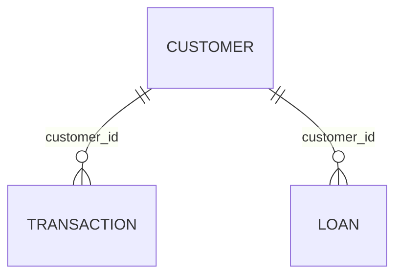

# Contrato y supuestos del conjunto sintético

Este es un ejercicio educativo. Los rangos, distribuciones y relaciones numéricas
de este documento son decisiones didácticas inventadas: **no son reglas reales,
umbrales regulatorios ni políticas de Banamex u otra institución**.

## Fuente de verdad

El archivo entregado fue `data/source/bank_metadata_simple (1).json`. Se conservó
intacto y se creó una copia de sus mismos bytes en
`data/source/bank_metadata.json`, la ruta canónica solicitada. El generador, la
migración y las pruebas leen la ruta canónica. No mantengas dos catálogos distintos:
realiza futuras revisiones en el canónico y revisa sus cambios junto con el SQL.

El JSON define las tablas, sus 14 columnas, tipos lógicos, unidades, dos claves
foráneas y los valores permitidos de segmento, riesgo y canal. No define
nulabilidad, rangos, distribuciones, cantidades o condiciones de otorgamiento.
Se interpreta `Unique ... identifier` como clave primaria del identificador de
cada tabla y se hacen obligatorios todos los campos por decisión del ejercicio.
No se añaden nombres, domicilios, cuentas, tarjetas, teléfonos, correos, fechas,
scores, garantías ni indicadores de fraude ausentes del catálogo.

| JSON | PostgreSQL | Decisión |
| --- | --- | --- |
| `STRING` | `TEXT` | No hay una longitud máxima especificada; se rechazan cadenas vacías. |
| `FLOAT` | `DOUBLE PRECISION` | Respeta el tipo aproximado del catálogo; los importes se generan a centavos. No es un modelo contable para producción. |
| `INTEGER` | `INTEGER` | `dpd` es un número entero de días. |

Se conserva exactamente la capitalización: `public."CUSTOMER"`,
`public."TRANSACTION"` y `public."LOAN"`. Deben citarse con comillas dobles en SQL;
`TRANSACTION` también es una palabra reservada. Las columnas conservan los nombres
en minúsculas del catálogo.



`CUSTOMER.customer_id` es la clave primaria del cliente. Los campos `customer_id`
de `TRANSACTION` y `LOAN` la referencian con `ON DELETE RESTRICT`. El esquema
permite varios préstamos por cliente; la muestra inicial asigna como máximo uno.

## Supuestos de generación

| Campo o aspecto | Regla del ejercicio |
| --- | --- |
| Cantidades | Exactamente 1,000 clientes, 5,000 transacciones y 500 préstamos. |
| Identificadores | `SYN-C-000001`, `SYN-T-000001`, `SYN-L-000001` y secuencias equivalentes; no son identificadores bancarios reales. |
| `segment` | Selección uniforme entre `MASS`, `PREMIER`, `PRIVATE`, tomados del catálogo. No representa proporciones reales. |
| `risk_level` | Selección uniforme entre `LOW`, `MEDIUM`, `HIGH`, independiente del segmento. No se calcula un score. |
| `annual_income` | MXN por año, uniforme a centavos: MASS 60,000–600,000; PREMIER 600,000–3,000,000; PRIVATE 3,000,000–12,000,000. Límites inclusivos. |
| Transacciones por cliente | Cinco por cada cliente, mediante asignación cíclica. No representa un período de tiempo porque el catálogo no define fechas. |
| `amount` | MXN, uniforme a centavos desde 10 hasta el menor entre 250,000 y la parte entera del 2% del ingreso anual. Solo positivos; no se modelan reversos. |
| `channel` | Selección uniforme entre los valores del JSON: `BRANCH`, `ATM`, `MOBILE`, `WEB`. |
| `merchant_category` | Selección uniforme de etiquetas inventadas: `SYNTHETIC_GROCERIES`, `SYNTHETIC_TRANSPORT`, `SYNTHETIC_UTILITIES`, `SYNTHETIC_EDUCATION`, `SYNTHETIC_HEALTH`, `SYNTHETIC_OTHER`. No son códigos MCC. El JSON permite texto libre; SQL no las convierte en un catálogo cerrado. |
| Prestatarios | Muestra sin reemplazo de 500 clientes, con la misma semilla; un préstamo por cliente seleccionado. No implica elegibilidad crediticia. |
| `balance` | Saldo positivo en MXN, uniforme a centavos desde 1,000 hasta el menor entre 3,000,000 y la parte entera de dos veces el ingreso anual. |
| `interest_rate` | Porcentaje anual: `12.50` significa 12.50%, no 0.125. Uniforme a dos decimales: LOW 5–15; MEDIUM 15–30; HIGH 30–60. Límites inclusivos; asociación inventada para el ejercicio. |
| `dpd` | Probabilidad didáctica de 75% de cero días. En el resto, uniforme entero entre 1 y 30/90/365 para LOW/MEDIUM/HIGH respectivamente. La muestra no tiene que reproducir exactamente ese porcentaje. |
| Nulos | Ninguno en esta versión; todos los campos tienen `NOT NULL`. |

No se determina si `amount` incluye comisiones de conversión. Esa ausencia del
catálogo se conserva y no debe inferirse a partir de los números generados.

## Reproducibilidad y controles

La semilla predeterminada es `20261020`. Se usa `random.Random(seed)` local,
sin reloj, servicios externos, Faker ni aleatoriedad global. Python está fijado
en `.python-version` a 3.13.5 y las dependencias en `uv.lock`. El conjunto y su
huella dependen también del catálogo, el algoritmo y los supuestos; una semilla
por sí sola no garantiza compatibilidad después de cambiar estos archivos.

SHA-256 esperado con esta versión y semilla:

```text
30fc34ef604fed893478ad4322c5b16d38cacc703b8eca592e696578f859eff5
```

La huella se calcula sobre las filas completas, ordenadas por clave primaria,
serializadas como JSON con claves ordenadas, separadores compactos y sin NaN.
Una prueba de regresión exige esa huella. Para otra semilla, las claves siguen
siendo las mismas; cambian los valores y algunos prestatarios.

SQL impone claves primarias, foráneas, obligatoriedad, texto no vacío, categorías
del catálogo y rangos globales. Los límites superiores rechazan también NaN e
infinito en PostgreSQL. La validación Python añade cantidades exactas, tipos,
unicidad y coherencia de ingresos/segmentos, importes/ingresos y tasas/mora/riesgo.
`verify` contrasta además todas las filas con la regeneración de la semilla.
Las reglas que cruzan campos o tablas son controles del generador/verificador;
no se implementan como triggers ni se afirman como restricciones SQL.

La migración se aplica en una sola transacción. `CREATE TABLE IF NOT EXISTS`
permite repetirla. El comando Python compara columnas, tipos, nulabilidad,
defaults y definiciones de restricciones con un modelo de referencia que crea
y revierte dentro de un savepoint. Si hay discrepancias, falla sin adaptar ni
destruir las tablas existentes. Por eso el método recomendado es `migrate`,
en lugar de ejecutar el SQL directamente. No modifica la extensión `vector`.

## Repetición y reinicialización

La carga toma bloqueos sobre las tres tablas para evitar carreras entre
generadores. Si están vacías, inserta todo y confirma una sola transacción. Si
contienen exactamente la muestra esperada, responde `sin cambios`. Cualquier
carga parcial, fila ajena, valor diferente o semilla diferente provoca un error
antes de insertar. No usa upsert ni omite conflictos silenciosamente.

Existe una opción de reinicialización, **no ejecutada durante la preparación**:
requiere conjuntamente `generate --reset --confirm-reset NOMBRE_EXACTO_BASE`.
El destino sigue limitado a `127.0.0.1:5434` y a la base de `.env`. Reemplaza
únicamente el contenido de las tres tablas, en orden hijo→padre y en una sola
transacción. No usa CASCADE, DROP, TRUNCATE ni elimina volúmenes. Aun así, elimina
el contenido de esas tablas: úsala solamente si has decidido reemplazarlo y
cuentas con respaldo de cualquier información que quieras conservar. Un fallo
revierte toda la operación. No es necesaria para repetir la generación normal.

Las pruebas de integración utilizan esquemas de nombres únicos distintos de
`public` y revierten siempre su transacción completa. No borran ni reemplazan
filas existentes del proyecto ni modifican contenedores o volúmenes.
